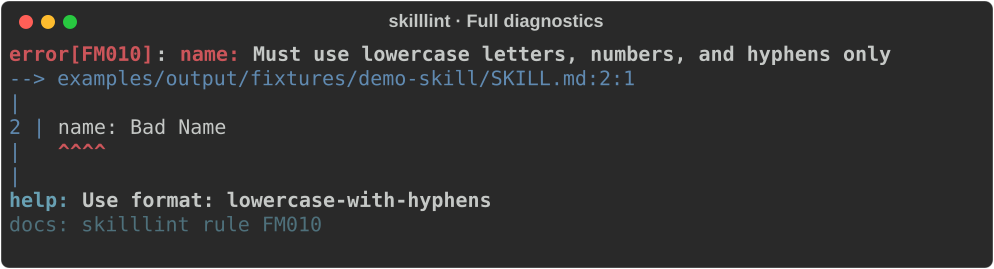

# skilllint

[](https://pypi.org/project/skilllint/)
[](https://pypi.org/project/skilllint/)
[](https://github.com/bitflight-devops/skilllint/blob/main/LICENSE)
[](https://github.com/bitflight-devops/skilllint/actions/workflows/test.yml)

Static analysis linter for AI agent plugins, skills, and agents — for Claude Code, Cursor, Codex, and any [agentskills.io](https://agentskills.io)-compatible platform.

---

## What it does

`skilllint` validates the structure and content of AI agent files: plugins, skills, agents, and commands. It catches broken references, missing frontmatter, oversized skills, invalid hook configurations, and more — before they cause silent failures at runtime.

```
$ skilllint check plugins/my-plugin

plugins/my-plugin/skills/my-skill/SKILL.md
  SK006  Token count 14823 exceeds recommended limit of 8192

plugins/my-plugin/agents/my-agent.md
  NR001  Namespace reference 'other-plugin:some-skill' — plugin directory not found

2 errors in 2 files
```

---

## Installation

```bash
pip install skilllint
```

Or with [uv](https://docs.astral.sh/uv/):

```bash
uv add skilllint          # add to a project
uv tool install skilllint # install as a global tool
```

**Requires Python 3.11–3.14.**

---

## Quick start

```bash
# Validate a plugin directory
skilllint check plugins/my-plugin

# Validate a single skill file
skilllint check plugins/my-plugin/skills/my-skill/SKILL.md

# Validate everything and show a summary
skilllint check --show-summary plugins/

# Auto-fix issues where possible
skilllint check --fix plugins/my-plugin

# Count tokens in any markdown file
skilllint check --tokens-only .claude/CLAUDE.md
```

Exit codes: `0` = all checks passed · `1` = validation errors · `2` = usage error

See [output examples](examples/output/README.md) for captured reports and colour SVG previews.

---

## Output formats

Choose a format for the reader or CI consumer. Every example below is captured
from the same deliberately invalid skill; the command exits `1`.

| Format | Use | Preview | Raw output |
| --- | --- | --- | --- |
| `full` | Human-readable source excerpts, highlights, and help | [Actual terminal colours](examples/output/full.svg) | [ANSI](examples/output/full.ansi) |
| `concise` | One monochrome finding per line for pre-commit | [Monochrome findings](examples/output/concise.svg) | [Text](examples/output/concise.txt) |
| `json-lines` | One parseable finding per line for agents | [JSONL preview](examples/output/json-lines.svg) | [JSONL](examples/output/json-lines.jsonl) |
| `github` | Native GitHub Actions annotations | [Command preview](examples/output/github.svg) | [Workflow commands](examples/output/github.txt) |
| `gitlab` | GitLab Code Quality artifacts | [Report preview](examples/output/gitlab.svg) | [JSON](examples/output/gitlab.json) |
| `junit` | JUnit-style test-report consumers | [Report preview](examples/output/junit.svg) | [XML](examples/output/junit.xml) |

For source-aware human diagnostics, use `skilllint check --output-format full`.
Colour defaults to terminal detection; choose `--color always` or `--color never`
independently of the format. Existing defaults and `--no-color` are preserved.



See the [complete six-format output gallery](examples/output/README.md) for
reproducible captures, raw reports, commands, and consumer-specific examples.
The machine-format SVGs are labelled report previews, not CI interface screenshots.

---

## GitHub Action

Use `bitflight-devops/skilllint` as a GitHub Action to validate skills, plugins, and agents in any repository.

For direct CLI use in Actions, `skilllint check --output-format github` emits
native workflow annotations. See the [captured commands and colour SVG preview](examples/output/README.md#github-annotations)
and [format contract](docs/usage.md#github-annotations).

For GitLab CI, `skilllint check --output-format gitlab` emits a Code Quality
JSON report. See the [raw report and colour SVG preview](examples/output/README.md#gitlab-code-quality)
and [CI configuration](docs/usage.md#gitlab-code-quality).

For test-report consumers, `skilllint check --output-format junit` emits
JUnit-style XML. See the [raw XML and colour SVG preview](examples/output/README.md#junit-style-xml)
and [result semantics and CI configuration](docs/usage.md#junit-style-xml).

Replace `X.Y.Z` in the examples with the release you intend to pin. The Action
ref and the `version` input pin the Action and the installed package
independently. Packages containing the structured Action runner produce annotations
and outputs from one scan, including `fix: true`, while keeping the requested
human log styling. Older pinned packages use an explicitly announced legacy
compatibility path: their historical output parsing may repeat a scan and does
not provide the new native annotations. This keeps existing package pins working.
`version: source` builds from a local Git checkout of this repository (including
its Git metadata) and tests unreleased changes with `uses: ./`. It is not intended
for GitHub's downloaded remote Action archive, which lacks version metadata.

```yaml
- uses: bitflight-devops/skilllint@vX.Y.Z
  with:
    paths: "plugins/"
    platform: "claude-code"
    version: "X.Y.Z"
    show-summary: "true"
```

### Full input reference

| Input | Description | Default |
|---|---|---|
| `paths` | Space-separated paths to validate | `.` |
| `platform` | Platform adapter: `claude-code`, `cursor`, `codex`; omit to validate each selected file with every matching adapter | _(matching adapters)_ |
| `fix` | Auto-fix issues where possible | `false` |
| `check-only` | Validate only, do not auto-fix | `false` |
| `verbose` | Show detailed output including info messages | `false` |
| `no-color` | Disable color output | `true` |
| `tokens-only` | Output only the integer token count | `false` |
| `show-progress` | Show per-file PASSED/FAILED status | `false` |
| `show-summary` | Show summary panel at the end | `true` |
| `filter` | Glob pattern to restrict files within a directory | _(none)_ |
| `filter-type` | File type filter: `skills`, `agents`, `commands` | _(all)_ |
| `version` | skilllint version to install (`latest`, `1.2.3`, or `source` for local Git checkout tests) | `latest` |
| `python-version` | Python version to use | `3.12` |

### Outputs

| Output | Description |
|---|---|
| `result` | `passed` when exit code is 0; `failed` for any non-zero exit code |
| `exit-code` | Raw exit code: `0` = pass · `1` = errors · `2` = usage error |
| `inspected-count` | Number of files inspected by skilllint |
| `findings` | Distinct finding codes emitted by skilllint |
| `tool-python` | Python runtime used by the installed skilllint tool |
| `tool-version` | Version reported by the installed skilllint tool |

### Example: fail the CI on validation errors

```yaml
name: Validate skills

on: [push, pull_request]

jobs:
  skilllint:
    runs-on: ubuntu-latest
    steps:
      - uses: actions/checkout@v4

      - name: Lint skills and plugins
        uses: bitflight-devops/skilllint@vX.Y.Z
        with:
          paths: "plugins/ .claude/"
          platform: "claude-code"
          version: "X.Y.Z"
          show-summary: "true"
          verbose: "false"
```

### Example: report results without blocking

```yaml
- name: Lint skills and plugins
  id: lint
  uses: bitflight-devops/skilllint@vX.Y.Z
  with:
    paths: "plugins/"
    version: "X.Y.Z"
  continue-on-error: true

- name: Print result
  run: echo "skilllint result=${{ steps.lint.outputs.result }}"
```

---

## Pre-commit hook

Install pre-commit, using Python 3.11–3.14 for the skilllint hook:

```console
python -m pip install pre-commit
```

Add to `.pre-commit-config.yaml`. Replace `X.Y.Z` with a release version that
includes the hooks and output format you need, or replace the entire `vX.Y.Z`
with a commit SHA. `vX.Y.Z` is a placeholder, not a published tag.

```yaml
repos:
  - repo: https://github.com/bitflight-devops/skilllint
    rev: vX.Y.Z
    hooks:
      - id: skilllint
```

Install the Git hook, then check all matching tracked files once:

```console
pre-commit install
pre-commit run skilllint --all-files
```

Later commits check matching staged files automatically. Pre-commit installs
skilllint in its own hook environment; a separate skilllint installation is not
needed for this configuration.

Both `skilllint` and `skilllint-fix` use `--output-format concise --no-color`:
one plain line per finding, with no progress or summary. To opt into fixes,
replace `id: skilllint` with `id: skilllint-fix`, then run
`pre-commit run skilllint-fix --all-files`. Review and re-stage changed files.
The fix hook keeps the same file selection and applies supported fixes in place.
See [pre-commit usage](docs/usage.md#pre-commit) for selected-file checks,
custom arguments, exclusions, and prek commands.
See the [captured concise output and SVG preview](examples/output/README.md#concise).

### Contributor quality checks (local)

Run this sequence before pushing:

```bash
# Auto-fix hooks first (whitespace, pypfmt, oxlint/oxfmt, ruff --fix, etc.)
uv run prek run --all-files

uv run pytest
```

---

## Platform support

`skilllint` ships with adapters for three platforms and supports third-party adapters via Python entry points:

| Platform | Adapter ID | Bundled |
|---|---|---|
| [Claude Code](https://claude.ai/code) | `claude-code` | ✓ |
| [Cursor](https://cursor.sh) | `cursor` | ✓ |
| [OpenAI Codex](https://platform.openai.com/docs/codex) | `codex` | ✓ |
| OpenCode, Gemini, and others | — | via entry points |

Restrict validation to one platform:

```bash
skilllint check --platform claude-code plugins/my-plugin
```

---

## Runtime rule reference

The installed runtime owns the active rule catalog, severity, platform scope,
fixability, and rule documentation. Query it directly instead of relying on a
copied table in this README:

```bash
skilllint rules
skilllint rule SK006
```

This keeps rule additions, retirements, and metadata changes synchronized with
the executable that will perform the scan.

## CLI reference

Use the executable's help for the current command and option inventory:

```bash
skilllint --help
skilllint check --help
skilllint rules --help
skilllint rule --help
skilllint docs --help
```

See [Usage and integrations](docs/usage.md) for maintained workflows and
configuration examples.

## Vendor documentation cache

`skilllint docs` provides the project's offline-first authority cache. Query
the current command surface with `skilllint docs --help`; see
[Vendor documentation cache](docs/vendor-cache.md) for cache ownership,
lifecycle, integrity, and contributor guidance.

## Suppressing warnings

Use a `.skilllint.json` file to suppress specific rule codes for a directory tree. Place the file at any level — skilllint walks up from each scanned file and uses the nearest config it finds.

```json
{
  "ignore": {
    "": ["AS008"],
    "skills/legacy": ["FM007", "SK006"]
  }
}
```

**Key format:**

| Key | Scope |
|---|---|
| `""` (empty string) | All files under this `.skilllint.json` |
| `"skills/legacy"` | Files whose path (relative to the config file) starts with that prefix |

**Plugin-level suppression** (inside a `.claude-plugin/` plugin):

Place `validator.json` inside `.claude-plugin/`:

```json
{
  "ignore": {
    "": ["PA001"],
    "agents/generated": ["FM004", "FM007"]
  }
}
```

The same key format applies. Plugin-level config takes priority over a `.skilllint.json` in a parent directory.

---

## Third-party adapters

Register a custom platform adapter via Python entry points in your `pyproject.toml`:

```toml
[project.entry-points."skilllint.adapters"]
my-platform = "my_package.adapter:MyPlatformAdapter"
```

Your adapter must implement the `AdapterProtocol` interface from `skilllint.adapters.protocol`.

---

## Links

- [Usage and integrations](docs/usage.md)
- [Architecture](docs/architecture.md)
- [Vendor documentation cache](docs/vendor-cache.md)
- [Maintainer extension guide](docs/maintainer-extension-guide.md)
- [Plugin overview](plugins/agentskills-skilllint/README.md)

- [GitHub repository](https://github.com/bitflight-devops/skilllint)
- [Issue tracker](https://github.com/bitflight-devops/skilllint/issues)
- [PyPI](https://pypi.org/project/skilllint/)
- [agentskills.io](https://agentskills.io)

---

## License

MIT
