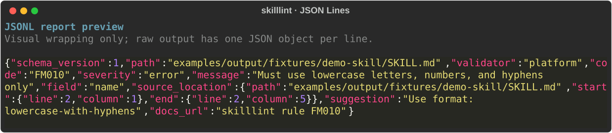
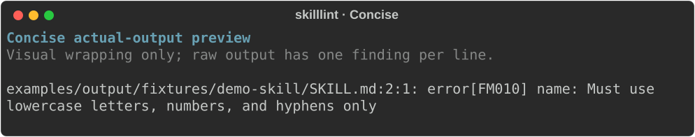
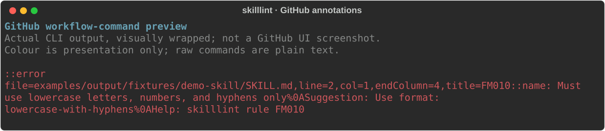

# Output examples

## JSON Lines

This **JSONL report preview** adds syntax colour and visual wrapping to the
[raw stdout](json-lines.jsonl) captured from the actual CLI. It is not a terminal
screenshot or a CI interface. Each record remains one physical line in the raw
file; the SVG does not change the report data.



Run from the repository root:

```console
uv run skilllint check --platform claude-code --output-format json-lines examples/output/fixtures/demo-skill/SKILL.md
```

The [fixture](fixtures/demo-skill/SKILL.md) deliberately contains an invalid name.
The command exits `1` because validation fails. See the
[JSONL contract](../../docs/usage.md#json-lines) for fields and exit semantics.

## Concise

This **concise actual-output preview** renders the [raw stdout](concise.txt)
captured from the CLI. Findings remain monochrome; the coloured frame and label
are presentation only. This is not a platform screenshot or a CI interface.
Visual wrapping keeps the preview readable; each finding remains one physical
line in the raw file.



Run from the repository root:

```console
uv run skilllint check --platform claude-code --output-format concise --no-color examples/output/fixtures/demo-skill/SKILL.md
```

The same deliberately invalid fixture exits `1`. Concise output contains only
findings, with no headings, fix suggestions, or summary.

## GitHub annotations

This **GitHub workflow-command preview** renders the [actual CLI stdout](github.txt)
with colour and visual wrapping for readability. It is not a GitHub interface
screenshot. The raw file contains plain workflow commands which GitHub Actions
interprets as error, warning, or notice annotations.



Run from the repository root:

```console
uv run skilllint check --platform claude-code --output-format github examples/output/fixtures/demo-skill/SKILL.md
```

The deliberately invalid fixture exits `1`. The command uses the real source
range, includes a suggestion, and percent-escapes embedded newlines. See the
[GitHub annotations contract](../../docs/usage.md#github-annotations).

## Reproduce the examples

Regenerate all artifacts, or verify they match without modifying them:

```console
uv run python scripts/capture_output_examples.py
uv run python scripts/capture_output_examples.py --check
```

The script preserves stdout bytes and uses a fixed SVG identifier and width.
Artifact comparisons and the SVG viewer normalize CRLF to LF so native Windows
output and checkout newline conversion do not create false drift. The raw JSONL
file retains the captured bytes. Only the known `vcs_versioning` shallow-checkout
warning is ignored during capture; other stderr diagnostics still fail the check.
The capture process pins `PYTHONIOENCODING=utf-8` for startup diagnostics as well
as the report, without changing the caller's environment.
Use the repository's locked dependencies to reproduce the preview.
