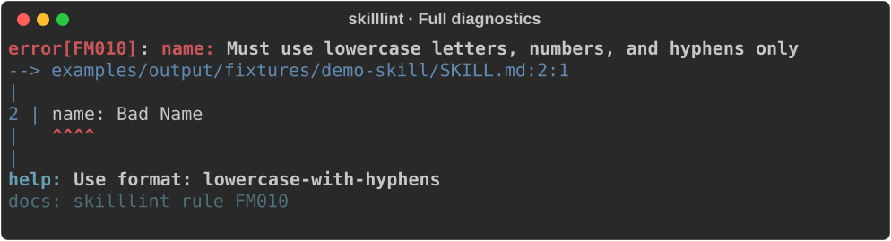
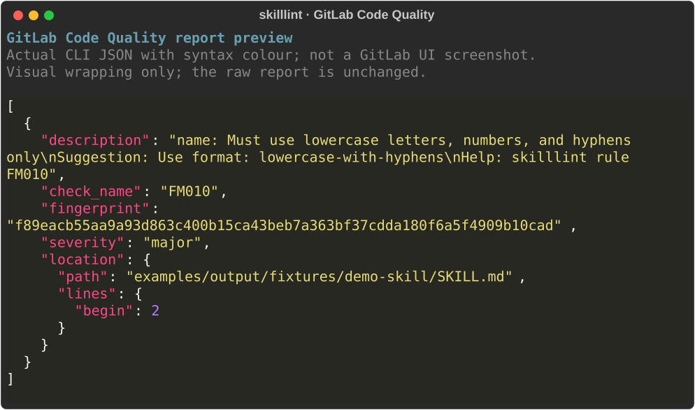
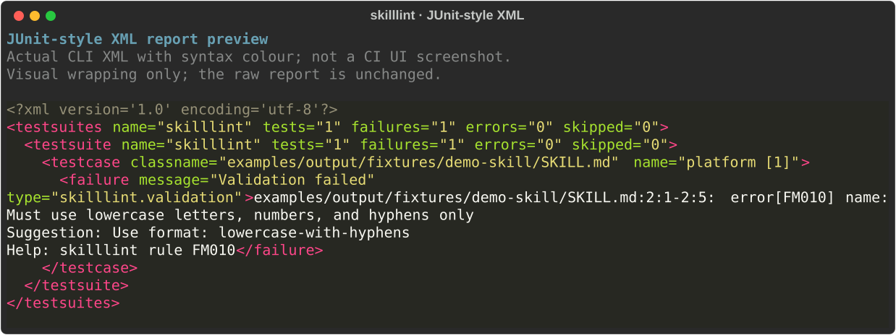

# Output examples

Compare skilllint's reports and choose the format your terminal, script, or CI service needs:

- [Full human diagnostics](#full-human-diagnostics): source excerpts, highlights, help, and colour.
- [Concise](#concise): monochrome, one finding per line for pre-commit.
- [JSON Lines](#json-lines): one finding record per line for scripts and agents.
- [GitHub annotations](#github-annotations): workflow commands interpreted by Actions.
- [GitLab Code Quality](#gitlab-code-quality): Code Quality JSON reports.
- [JUnit-style XML](#junit-style-xml): test-result XML, distinct from xUnit.net XML.

Every example checks the same [deliberately invalid skill](fixtures/demo-skill/SKILL.md), whose name contains uppercase letters and a space. Each command exits `1` because validation fails. Run the commands from a checkout of this repository with its dependencies installed.

The full preview preserves terminal colours from the CLI. The other SVGs use viewer-only colour or visual wrapping for readability and are not screenshots of GitHub, GitLab, or a test UI. Use the linked raw files, rather than SVG text, as machine-readable reports.

## Full human diagnostics

Read findings alongside source excerpts and caret highlights. The preview preserves the colours and layout of the [captured terminal output](full.ansi) at 100 columns.



```console
uv run skilllint check --platform claude-code --output-format full --color always examples/output/fixtures/demo-skill/SKILL.md
```

For interactive use, omit `--color always` to detect terminal colour support automatically. See [full human diagnostics](../../docs/output-formats.md#full-human-diagnostics) for source-location and recording behaviour.

## Concise

Use one plain line per finding in hooks and logs. The [raw output](concise.txt) is monochrome, without headings, fix suggestions, or a summary. The preview adds a frame and wraps the line visually.


```console
uv run skilllint check --platform claude-code --output-format concise --no-color examples/output/fixtures/demo-skill/SKILL.md
```

See [concise output](../../docs/output-formats.md#concise) for fields and [pre-commit setup](../../docs/usage.md#pre-commit) to use this format in a hook.

## JSON Lines

Use a flat stream of findings in scripts and agents. Each record occupies one physical line in the [raw JSONL](json-lines.jsonl); the preview adds syntax colour and visual wrapping.


```console
uv run skilllint check --platform claude-code --output-format json-lines examples/output/fixtures/demo-skill/SKILL.md
```

See the [JSON Lines reference](../../docs/output-formats.md#json-lines) for fields, source ranges, and exit semantics.

## GitHub annotations

Emit annotations from a GitHub Actions `run` step. The [raw workflow command](github.txt) includes the rule code, source range, message, suggestion, and help reference. GitHub interprets the command when it runs in Actions; the preview below shows the command itself.


```console
uv run skilllint check --platform claude-code --output-format github examples/output/fixtures/demo-skill/SKILL.md
```

See the [GitHub annotations reference](../../docs/output-formats.md#github-annotations) or use the [skilllint Action](../../docs/usage.md#github-action).

## GitLab Code Quality

Publish findings as a GitLab Code Quality report. The [raw JSON array](gitlab.json) contains the description, rule code, fingerprint, severity, and repository-relative location.



```console
uv run skilllint check --platform claude-code --output-format gitlab examples/output/fixtures/demo-skill/SKILL.md
```

See [GitLab CI setup](../../docs/usage.md#gitlab-code-quality) to publish the report. The [GitLab Code Quality reference](../../docs/output-formats.md#gitlab-code-quality) covers fingerprint behaviour, severity mapping, and findings that this format cannot represent.

## JUnit-style XML

Publish validation results to a JUnit report consumer. In the [raw XML](junit.xml), the fixture's single validator result becomes one failed testcase containing the finding and help text.



```console
uv run skilllint check --platform claude-code --output-format junit examples/output/fixtures/demo-skill/SKILL.md
```

See [JUnit-style XML](../../docs/output-formats.md#junit-style-xml) for result semantics and [JUnit CI setup](../../docs/usage.md#junit-style-xml) to publish the report.

## Reproduce the examples

From the repository root, use its locked dependencies to regenerate the reports and previews, or check for differences without changing files:

```console
uv run python scripts/capture_output_examples.py
uv run python scripts/capture_output_examples.py --check
```

The capture script keeps raw stdout bytes and uses fixed SVG identifiers and dimensions. It sets UTF-8 output encoding; the full capture also sets `COLUMNS=100`, `LINES=24`, and `TERM=xterm-256color`. Comparisons normalize CRLF to LF to account for Windows line endings. The known `vcs_versioning` shallow-checkout warning is ignored; other stderr diagnostics fail the check.
